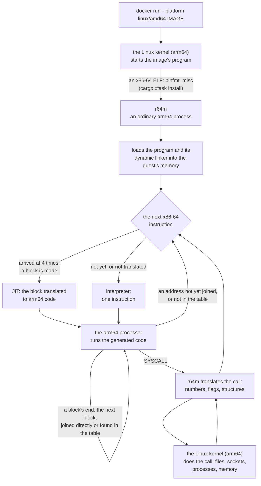
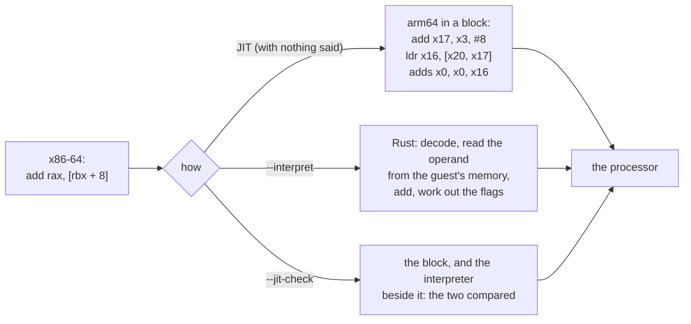
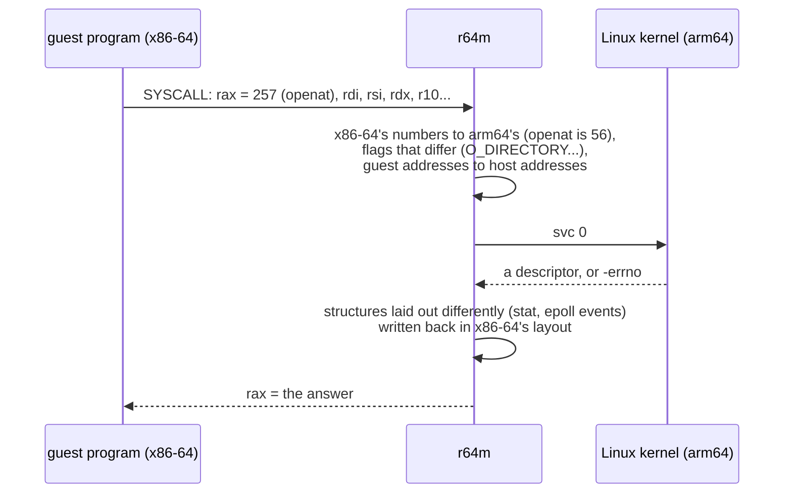

# How an x86-64 instruction is run

From `docker run` to the arm64 processor: what r64m does with an x86-64 program's
instructions, its system calls and its signals. The decisions behind each part are in
`docs/adr/`; the numbers in [experiments.md](experiments.md).

## The whole way



There is no second kernel and no device: the program's files, sockets, processes and
memory are the host kernel's, and only its instructions are r64m's to run
([0017](adr/0017-the-containers-way.md), [0018](adr/0018-one-thing-well.md)).

## One instruction, three ways



- The guest's registers are the host's: `rax` is `x0`, `rbx` is `x3`, and so on to
  `r15` in `x15` ([0014](adr/0014-the-jit.md)).
- The guest's memory is the host's, at an offset kept in `x20`: guest address `g` is
  host address `base + g`, one instruction ([0008](adr/0008-a-programs-memory-is-the-hosts.md)).
  A page the guest may not touch is one the host has closed, and the host's fault is
  handed to the guest as its own SIGSEGV.
- The flags are worked out only where something reads them: often the host's own
  NZCV answers the next jump; otherwise a short record is kept and settled when
  needed (R009, R013 to R015).
- Between threads memory is ordered as x86 orders it: by the processor itself where
  it can (Apple's processors, when the kernel lets a thread ask), by ordered loads and
  stores elsewhere ([0019](adr/0019-threads-and-signals.md)).

## A system call



Most calls go to the kernel with their arguments as they are; r64m translates what
differs between the two architectures, and does itself what only it can know:
`execve` starts r64m again for the new program, `clone` makes a host thread with its
own generated code, `mmap` keeps r64m's list of the guest's memory in step.

## A signal

```mermaid
sequenceDiagram
    participant K as Linux kernel (arm64)
    participant R as r64m's handler
    participant B as generated code
    participant G as guest's handler (x86-64)
    K->>R: SIGINT for this thread
    R->>R: noted; the thread's word set
    R-->>B: back to the block
    B->>B: at the start of a block a loop goes through:<br/>the word is set, the block is left
    B->>G: a frame built on the guest's stack<br/>as Linux builds one on x86-64
    G->>R: rt_sigreturn
    R->>B: the registers put back; on from where it was
```

A fault in generated code (a load or store the host refused) is the same way round:
r64m's handler sends the thread out of the block, the interpreter meets the
instruction again, and the guest's handler for SIGSEGV is entered if the guest has
one ([0019](adr/0019-threads-and-signals.md)).

## What is r64m's own, and what is not

| | whose |
|---|---|
| decoding and running x86-64 instructions | r64m (interpreter and JIT) |
| the guest's registers, flags, the x87 and SSE state | r64m |
| translating system calls and signal frames between the two architectures | r64m |
| memory: pages, protection, faults | the host kernel and processor (r64m keeps the list) |
| files, sockets, processes, time, users | the host kernel |
| scheduling threads and cores | the host kernel |
| isolation between containers | the host kernel (r64m is not a boundary of security) |
